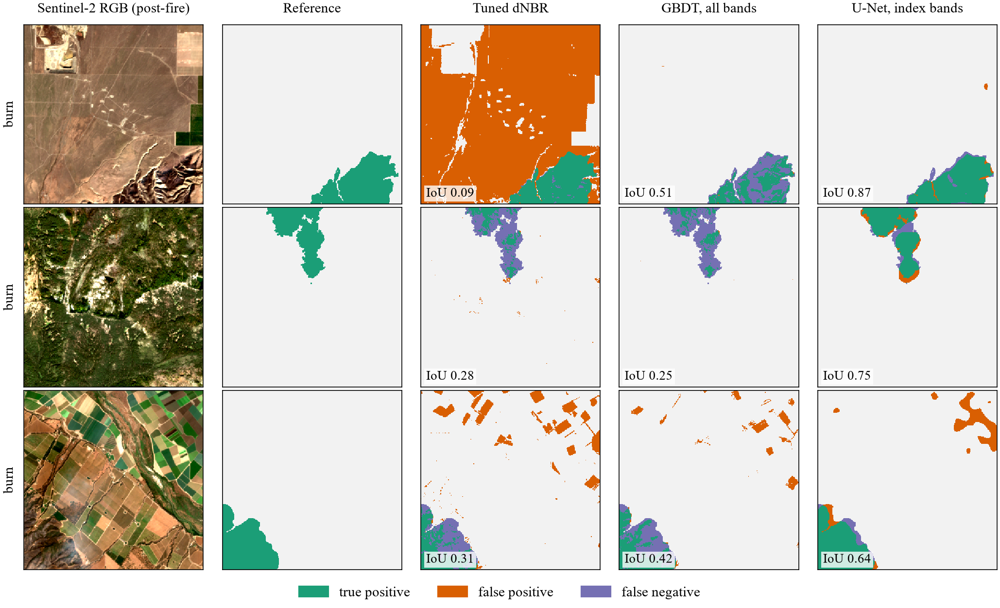
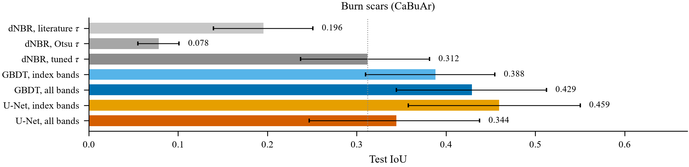
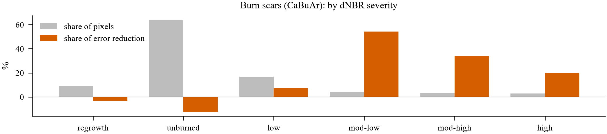
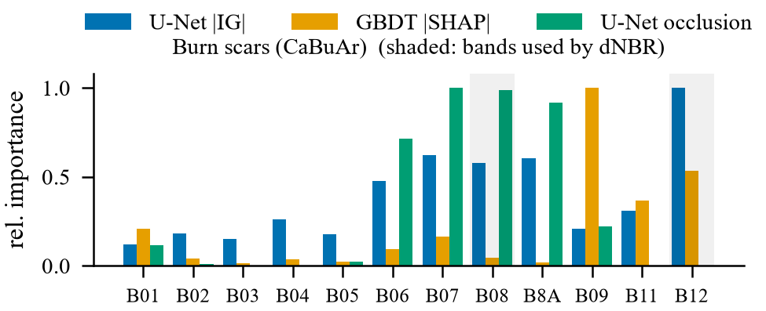

<div align="center">

# Disentangling Spectral and Spatial Evidence in Deep Burn-Scar Segmentation

### A Factorial Ablation with Faithfulness-Checked Attributions

**Inayat Arshad**

[](paper/main.pdf)
[](pyproject.toml)
[](https://pytorch.org)
[](https://sentinels.copernicus.eu/web/sentinel/missions/sentinel-2)
[](LICENSE)



</div>

---

## Overview

Operational burn-scar mapping still relies on the differenced Normalized Burn Ratio (**dNBR**). Deep segmentation networks usually score higher, but a single
IoU number does not tell an analyst *whether* replacing a transparent index is worth it.
This repository answers two narrower questions:

1. **When** does a network beat the index? The test pixels are stratified by burn severity,
   land cover, index ambiguity and distance to object boundaries.
2. **Why** does it win? The network may learn a better decision rule over the same bands, use
   bands the index ignores, or exploit spatial context.

To separate these explanations, the learned models form a **2 × 2 factorial ablation**. Each one
is compared against the index under three thresholds: literature, Otsu, and tuned on the
training labels.

|                      | per pixel (GBDT) | spatial (U-Net) |
|----------------------|:----------------:|:---------------:|
| **index bands only** | `lgbm_index`     | `unet_index`    |
| **all 12 S2 bands**  | `lgbm_all`       | `unet_all`      |

Moving along the rows and columns isolates three effects: **rule** (threshold → learned model on
the same bands), **spectrum** (index bands → all bands) and **space** (per pixel → convolutional).

The attributions themselves are tested rather than shown as pictures:

- **Exact TreeSHAP** on the per-pixel GBDT models.
- **Integrated Gradients** and **GradientSHAP** on the U-Nets.
- **Band occlusion** as a model-agnostic deletion test, applied to every method including the index.
- **Faithfulness checks:** Spearman agreement between the attribution views, and a weight-randomisation
  sanity check.
- **Context radius:** the distance from a pixel within which 50% and 90% of the network's evidence for it lies.

## Results

All numbers below are produced by `scripts/make_paper_assets.py` from the run outputs. They are the
same numbers that appear in the paper.

<div align="center">

</div>

<table>
<tr>
<td width="50%"></td>
<td width="50%"></td>
</tr>
</table>

The full tables, with 95% bootstrap confidence intervals over test chips, are in [`paper/main.pdf`](paper/main.pdf).

## Data

| Task | Imagery | Reference | Access |
|------|---------|-----------|--------|
| Burn scars | Sentinel-2 L2A, pre- and post-fire, California 2015–2022 (24 channels) | CAL FIRE perimeters (CaBuAr) | [Hugging Face](https://huggingface.co/datasets/DarthReca/california_burned_areas), `raw/patched/512x512.hdf5` |
| Tree cover (extension, not in the paper yet) | Sentinel-2 L2A median composite, 2021 growing season, 7 regions (12 channels) | ESA WorldCover 2021, class 10 | [Microsoft Planetary Computer](https://planetarycomputer.microsoft.com) STAC, no account needed |

The CaBuAr splits follow the dataset's folds: 0–2 train, 3 validation, 4 test. Each forest region is cut
into contiguous west-to-east blocks (60/20/20%) to limit spatial leakage between splits.

## Reproducing the paper

```bash
git clone https://github.com/inayatarshad/beyond-spectral-indices.git
cd beyond-spectral-indices
pip install -e ".[forest]"
```

Run the full pipeline (both tasks, then tables and figures):

```bash
bash scripts/run_all.sh burn
```

Or run each stage on its own:

| Stage | Command | Output |
|-------|---------|--------|
| Data | `python scripts/prepare_data.py configs/burn.yaml` | `data/burn/chips/{train,val,test}/*.npz` |
| Index threshold | `python scripts/fit_index.py configs/burn.yaml` | `runs/burn/index_thresholds.json` |
| Learned models | `python scripts/train.py configs/burn.yaml unet_all` | `runs/burn/unet_all/model.pt` |
| Evaluation ("when") | `python scripts/evaluate.py configs/burn.yaml` | `runs/burn/eval/*.csv` |
| Attribution ("why") | `python scripts/explain.py configs/burn.yaml` | `runs/burn/explain/*` |
| Paper assets | `python scripts/make_paper_assets.py configs/burn.yaml configs/forest.yaml` | `paper/tables`, `paper/figures` |

Set `BSI_ROOT=/path/to/large/disk` to keep data and runs outside the repository.
The reported runs used a 6-core laptop CPU, with no GPU, and 128 × 128 training crops. The exact
settings are in [`configs/`](configs). On a GPU, raising `crop_size` and `epochs` is the only change needed.

The manuscript is in [`paper/`](paper). It uses the standard `IEEEtran` class and compiles with
`pdflatex main && bibtex main && pdflatex main && pdflatex main` or on Overleaf.

## Repository layout

```
configs/            task configurations (data source, splits, models, attribution settings)
src/bsi/
  data/             CaBuAr reader, Planetary Computer composites, chip format
  indices.py        NDVI / NBR / dNBR and literature, Otsu and tuned thresholds
  models.py         the 2x2 ladder: LightGBM and channel-selecting U-Nets
  strata.py         per-pixel strata (severity, land cover, index margin, boundary)
  explain.py        IG, GradientSHAP, TreeSHAP, occlusion, context radius
  metrics.py        pooled confusion counts and metrics
scripts/            pipeline stages
paper/              IEEE manuscript, bibliography, generated tables and figures
notebooks/          Colab runner for GPU reproduction
```

## Citation

```bibtex
@misc{arshad2026disentangling,
  author = {Arshad, Inayat},
  title  = {Disentangling Spectral and Spatial Evidence in Deep Burn-Scar Segmentation:
            A Factorial Ablation with Faithfulness-Checked Attributions},
  year   = {2026},
  note   = {Preprint},
  url    = {https://github.com/inayatarshad/beyond-spectral-indices}
}
```

## Acknowledgements

The study uses the CaBuAr dataset (Rege Cambrin, Colomba and Garza) and Copernicus Sentinel-2 data,
accessed through Hugging Face and the Microsoft Planetary Computer, and the ESA WorldCover 2021 product.

## License

Code: [MIT](LICENSE). The datasets keep their own licences: CaBuAr is CDLA-Permissive-2.0, Copernicus
Sentinel data and ESA WorldCover are CC-BY 4.0.
